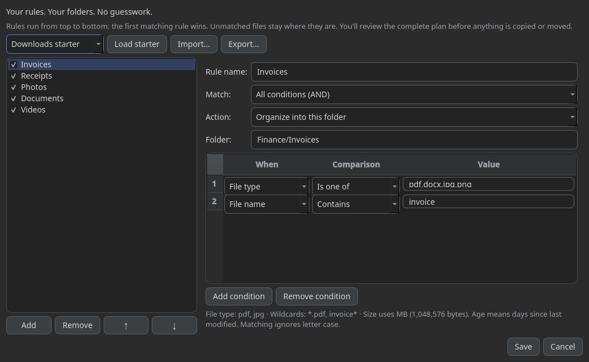

👉 **[Download SortOut 2.3.0 for Windows — SortOut.exe](https://github.com/OfficialAshish/SortOut/raw/main/executable/dist/SortOut.exe)**
· [SortOut-cli.exe](https://github.com/OfficialAshish/SortOut/raw/main/executable/dist/SortOut-cli.exe) (command line)
· [SHA256SUMS.txt](https://github.com/OfficialAshish/SortOut/raw/main/executable/dist/SHA256SUMS.txt)

# SortOut 2.3.0 — Smart File Organizer for Windows

**Your rules. Your folders. No guesswork.**
Choose a folder → choose how to organise it → scan and review → apply.
Scanning changes no source files. Copy is the default for organising; Move is optional.
Undo is available in the app and History. No installer required.


*Example rule editor; platform appearance may vary.*

## Free vs Pro
| Feature | Free | Pro |
|---|:---:|:---:|
| Smart Rules · By File Type · Smart Name Grouping · Date Organizer · By File Size · Keyword Tagger · Custom Pattern · Move All Together | ✅ | ✅ |
| Preview every available algorithm | ✅ | ✅ |
| Duplicate Finder — exact matches, choose kept copies, extras to the Recycle Bin with Undo | 👀 preview | ✅ cleanup |
| AI Grouping — OpenAI, Gemini, Claude, custom OpenAI-compatible services, local Ollama | 👀 preview | ✅ apply |
| Ignore Manager · editable plans · Profiles · History and Undo · dark mode · command line | ✅ | ✅ |

Project / Code Detector is **parked for a future release** and is not available
in the picker or command line. The Developer Workspace preset is parked too.

Buying, activation and privacy: [docs/FREEMIUM.md](docs/FREEMIUM.md).

## Get started
1. Download `SortOut.exe` and run it. If replacing an older copy, close the old
   process first and launch the newly downloaded file.
2. Drag a folder onto **Choose a folder** or click **Browse…**.
3. Pick an algorithm. For normal organising, click **Scan & Preview**; review
   the plan, rename or rearrange groups, then choose Copy or Move and Apply.
4. During Apply, the progress bar is busy while preparing/checking space/saving
   undo data, then shows a count such as **Moving 1,200 of 10,000…**.
5. To undo, use **Undo** in the result/preview or **File → History…**.

Windows SmartScreen may warn about an unsigned app. Verify the download before
choosing to run it. In PowerShell, `Get-FileHash SortOut.exe -Algorithm SHA256`
must match its entry in `SHA256SUMS.txt`.

## New in 2.3: Smart Rules — Free, offline, repeatable
Pick **Smart Rules → Edit rules…**. Start with Downloads starter, Office tidy,
or Large & old files, then adjust conditions for file type, name, relative path,
size (MB) and days since modified. Combine All/Any conditions, set a destination
such as `Finance/Invoices`, and reorder rules: **first match wins**.
A Keep in place rule protects matching files from sorting; unmatched files also
stay put. This is not a security lock: preview edits can change a decision.

**Scan & Preview** shows the plan before any file changes. Hover a file to see
its original scan rule. Choose Copy (default) or Move and apply the reviewed plan.
Save your setup as a profile for repeat use, or Import/Export rules as JSON in
the editor. No AI key, subscription, file-content reading or silent background
moves. Source subfolders are preserved unless you choose Discard file paths.

[Smart Rules step-by-step guide and JSON examples](docs/SMART_RULES.md).

## Duplicate Finder
Choose **Duplicate Finder**, then **Find duplicates**. Size checks and bounded
head/tail samples rule out candidates; full SHA-256 confirms remaining large
matches. Verification shows files, MiB read and the current path. Cancel is
available during the scan. Whole-drive scans still depend on file count,
storage speed, antivirus, permissions and cloud-file downloads.

**Repeat scans:** the new local cache can avoid rereading full contents for
eligible unchanged files of at least 1 MiB. Every hit still needs fresh metadata,
identity/change stamps and head/tail samples. On Windows it requires a fixed
local drive with a reliable change stamp. Unsupported storage, locks or corrupt
cache data use fresh hashing instead. The review shows reused hashes and avoided
full reads. Enumeration, permission checks and sample reads still take time;
first-time scans of large drives are not instant.

Settings → Organizing → **Remember duplicate hashes** disables caching;
**Clear scan cache** clears only derived hashes, not your files or Undo history.
Cache validity is 7 days, capped at 20,000 entries. Cleanup never relies solely
on cached hashes: full contents are rechecked before binning.

After scanning and background report preparation, the duplicate review opens.
Large reviews start collapsed; expand a set to inspect copies. **Ticked copies
are kept**. Only after confirmation does Pro cleanup send unticked copies to the
Recycle Bin. At least one copy remains; changed files are skipped, with full
content rechecked before cleanup. Software-project copies are protected by
default. Scanning does not move anything.

Undo can restore copies from the bin unless it was emptied or files are missing.
Cleanup requires a supported fixed local Windows drive; network/removable drives
and paths too long for the Windows recycle operation are refused rather than
permanently deleted. Avoid blindly cleaning application/system folders.

## Command line
`SortOut-cli.exe` is the console twin for scripts:
```bat
SortOut-cli.exe "C:\Users\me\Downloads" --dry-run
SortOut-cli.exe D:\Photos -a date_organizer --granularity year -y
SortOut-cli.exe D:\Inbox --discard-paths --skip-hidden --move --prune-empty-dirs -y
SortOut-cli.exe D:\Photos -a duplicate_finder --dry-run
SortOut-cli.exe "C:\Users\me\Downloads" -a smart_rules --dry-run
SortOut-cli.exe D:\Inbox -a smart_rules --rules-file my-rules.json --move -y
SortOut-cli.exe D:\Photos -a duplicate_finder --no-scan-cache --dry-run
SortOut-cli.exe --clear-scan-cache
SortOut-cli.exe --history
SortOut-cli.exe --revert "D:\Photos\SortedOut" -y
SortOut-cli.exe --help
```
Duplicate Finder apply is a bin-cleanup operation, not ordinary copy/move sorting.
`--revert` also accepts a History operation ID. Exit codes: `0` success,
`1` error, `2` usage/bad folder, `3` Pro required, `4` AI failure,
`5` partly reverted, `130` cancelled.

**Retry skipped files is not included in this release.** Skipped files stay
where they are and appear in the result/History; a retry shortcut is proposed
for a later version.

## Data and privacy
No telemetry. The local duplicate-hash cache stores hashed path keys, signatures
and digests, not plaintext paths or contents. Settings, profiles, undo history, ignore rules and logs stay in
`%USERPROFILE%\.sortout` (or `SORTOUT_HOME`). AI keys are protected with Windows
DPAPI. AI Grouping sends **file names only**, never file contents, after consent;
local Ollama runs on your computer. SortOut does not write ignore rules or undo
journals into the folders being organised.

## Support
Feedback and licence questions: aashish06327@gmail.com

© 2026 OfficialAshish. All rights reserved. SortOut is proprietary software.
